

  

<h1 align="center">Skulpt Body</h1>

  Carnet de musculation pour Android, basé sur <a href="https://github.com/skulptapp/skulpt">Skulpt</a>. 
  Gratuit, sans compte, sans pub : tes données restent sur ton téléphone.

  

  
  &nbsp;
  

  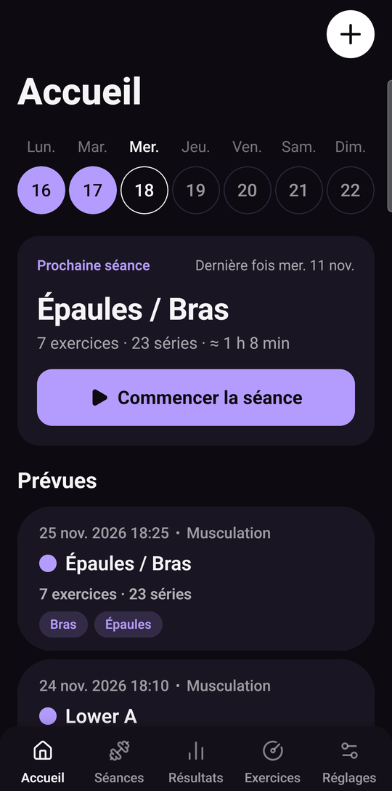
  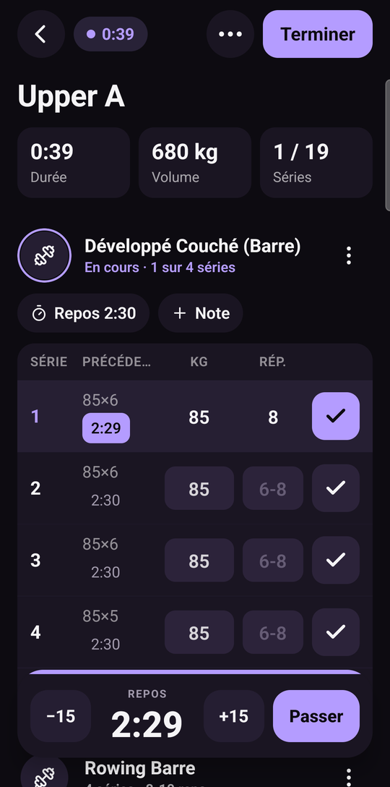
  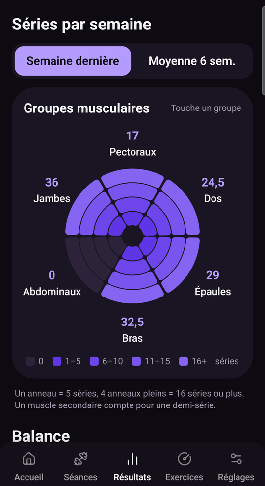
  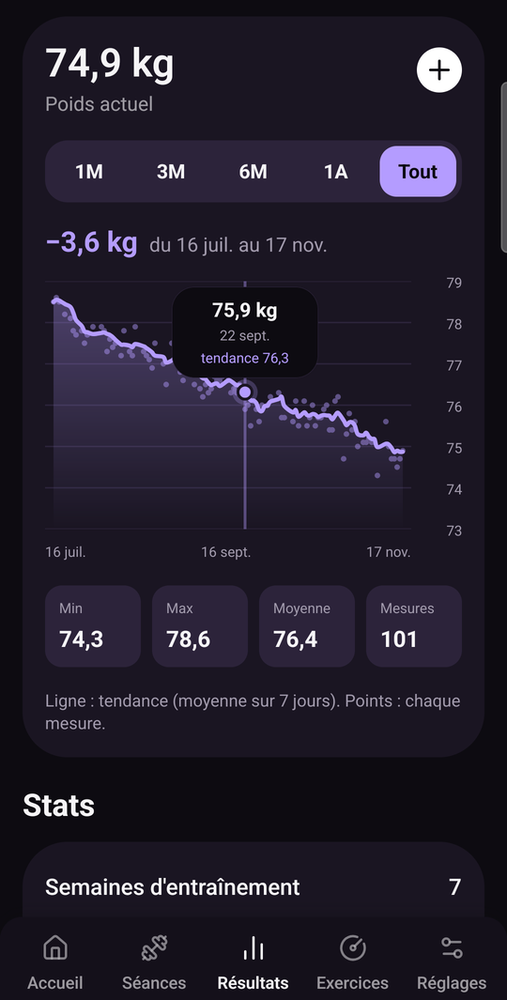

Captures faites avec des données de démonstration.

## Installer

1. Sur ton téléphone Android, touche **Download APK** ci-dessus.
2. Ouvre le fichier téléchargé et autorise l'installation d'applis inconnues si Android le demande. Si Play Protect propose d'analyser l'appli, choisis « Ne pas envoyer » puis « Installer quand même ».
3. C'est prêt. Pour mettre à jour, refais la même chose : la nouvelle version s'installe par-dessus et garde tes séances.

Le détail de chaque version est dans les [Releases](https://github.com/alexistrihine-pixel/skulpt-body/releases).

## Fonctionnalités

### Accueil

- La semaine en cours en haut, avec les jours où tu t'es entraîné.
- **Prochaine séance** : le programme que tu as fait il y a le plus longtemps, avec son nombre d'exercices, de séries et sa durée estimée, et un bouton pour la lancer.
- Tes séances prévues et terminées, rangées par semaine.

### Séance en cours

  
  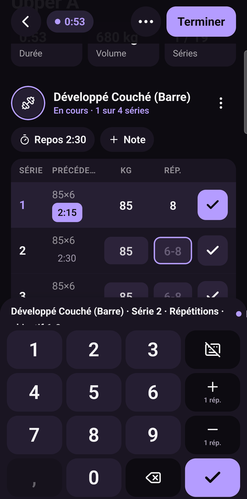

- Tous les exercices de la séance sur une seule page, chacun avec son tableau de séries : numéro, **précédent** (ce que tu as fait la dernière fois), kg, répétitions et un bouton ✓ par série.
- **Fourchettes de répétitions** (par exemple 6-8) affichées dans la case tant que tu n'as rien saisi.
- **Pavé numérique intégré** : +1 / −1, passage au champ suivant, et la touche ✓ sur le dernier champ valide la série.
- **Chrono de repos** ancré en bas de l'écran, lancé automatiquement à chaque série validée, avec −15 s / +15 s et « Passer ». La durée par défaut et le démarrage auto se règlent dans Réglages › Minuteur de repos.
- Durée, volume total et séries faites sur la séance en haut ; « Terminer » toujours accessible.
- Types de séries (échauffement, travail, dégressive, échec), séries en temps ou en distance, supersets et circuits.
- **Notes par exercice et par salle** : pratique quand tu t'entraînes dans deux salles aux machines différentes.

### Séances (programmes)

  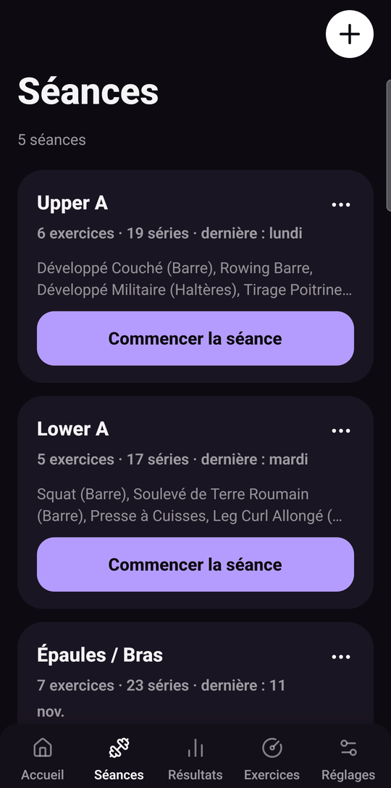

- Tes programmes (Upper, Lower, Push…) avec leurs exercices, leurs séries, leurs fourchettes de répétitions et la date de la dernière fois.
- Une touche pour lancer la séance, pré-remplie avec tes charges.

### Résultats

  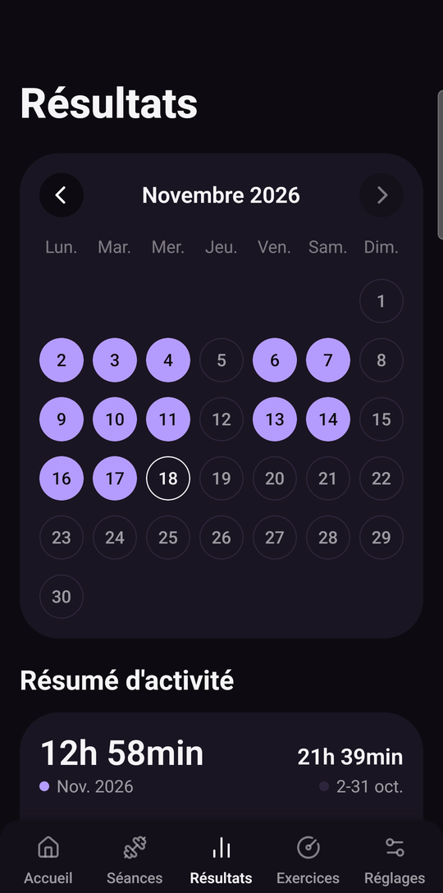
  
  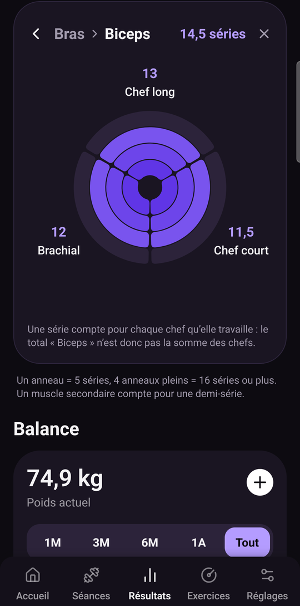
  

- **Calendrier** des jours d'entraînement et **résumé d'activité** (temps passé à la salle, comparé au mois précédent).
- **Séries par semaine** en anneaux, sur la semaine dernière ou en moyenne sur 6 semaines. Touche un groupe (Bras) pour voir ses muscles, puis un muscle marqué › (Biceps) pour voir chaque chef (chef long, chef court, brachial). Muscle principal = 1 série, secondaire = ½.
- **Courbe de poids** (et de masse grasse) sur 1 mois, 3 mois, 6 mois, 1 an ou tout, avec une ligne de tendance sur 7 jours. Reste appuyé sur la courbe pour lire une pesée.
- Statistiques globales : semaines et jours d'entraînement, heures, séances, volume, séries, répétitions.

### Exercices

  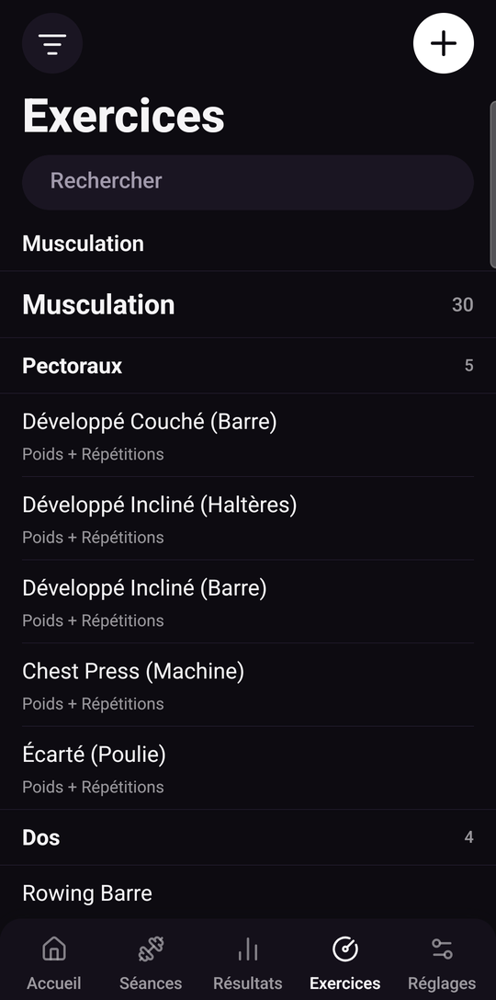
  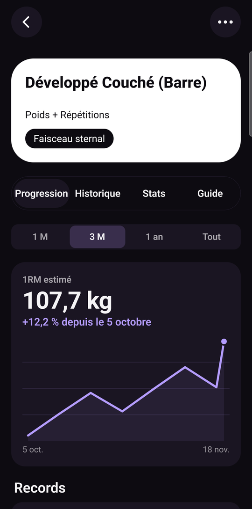

- Ta bibliothèque d'exercices, rangée par groupe musculaire, avec recherche.
- Muscles principaux et secondaires détaillés jusqu'aux chefs et faisceaux (faisceau claviculaire, chef long du triceps…).
- Fiche de chaque exercice : **progression** du 1RM estimé, historique des séances, records et statistiques.

### Réglages

  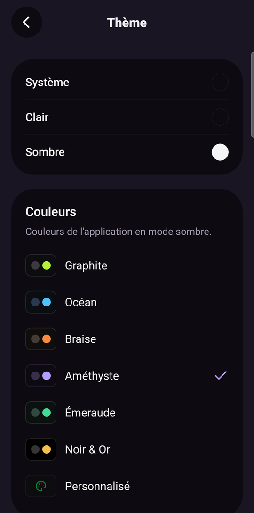

- **Couleurs** : violet par défaut, 5 autres palettes sombres ou la tienne (Réglages › Thème).
- Thème clair, sombre ou celui du système ; unités kg/lb ; langue ; sons et vibrations.
- Tout en français. Les données sont stockées sur le téléphone : pas de compte, pas de synchronisation, pas de pub.

## Crédits et licence

Ce fork n'est ni affilié ni soutenu par l'équipe Skulpt : merci aux auteurs d'origine. Comme l'original, il est distribué sous licence [GPL-3.0](./LICENSE) ; le code de chaque APK est celui du tag de la release.

Certaines fonctionnalités s'inspirent d'applications de suivi existantes, dont Hevy. Hevy est une marque de ses propriétaires ; ce projet n'est ni affilié ni soutenu par Hevy.

Pour les développeurs : le README d'origine (architecture, commandes, build) est dans [README.upstream.md](./README.upstream.md).
